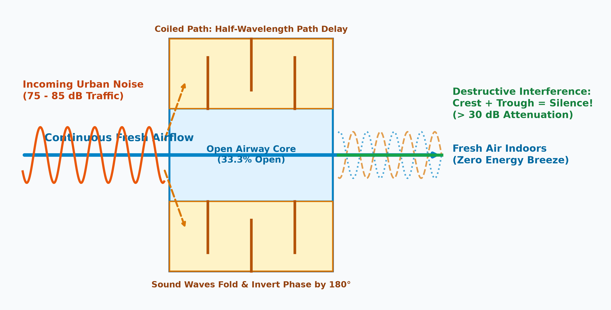
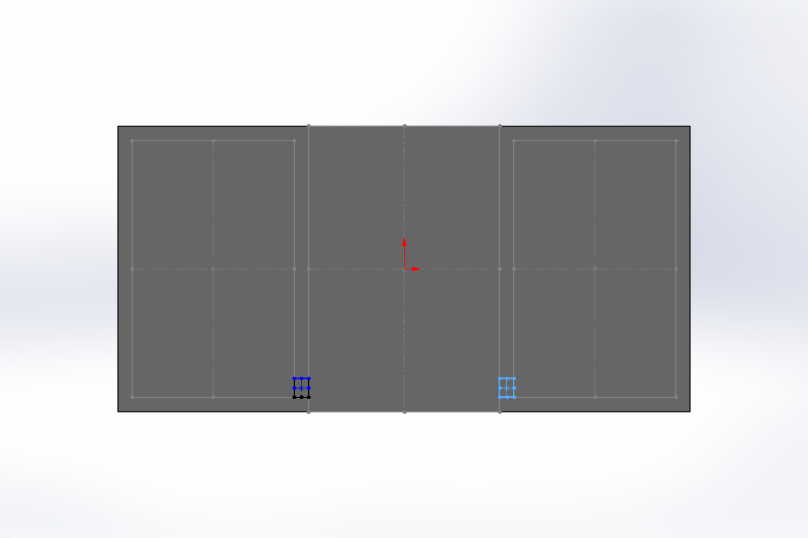
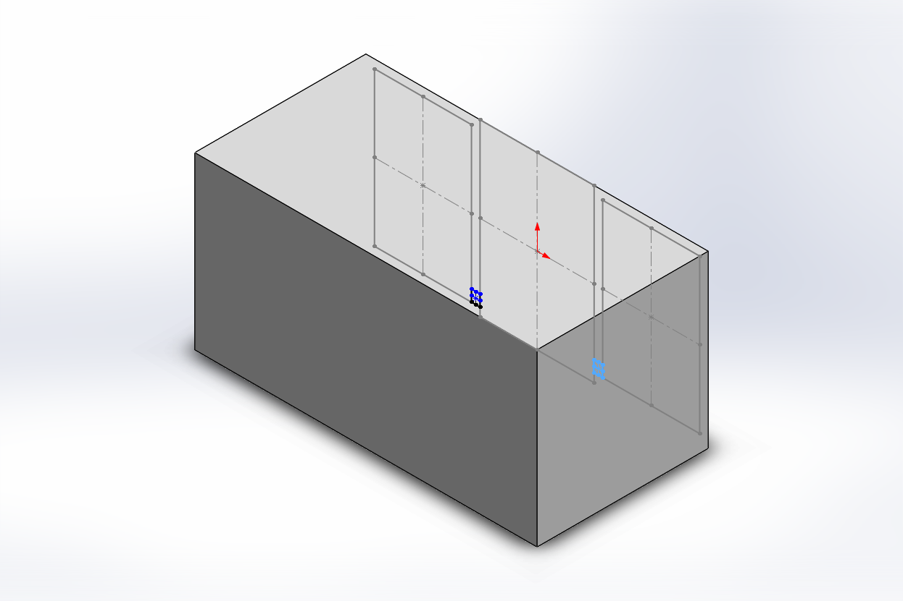
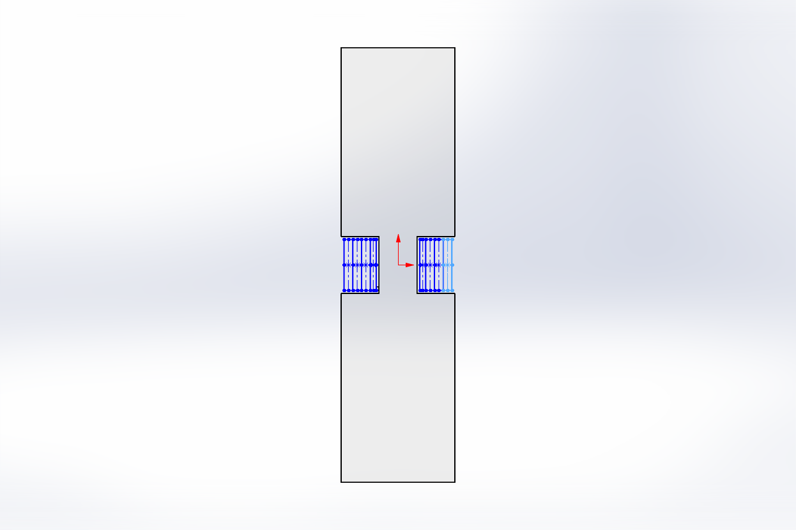
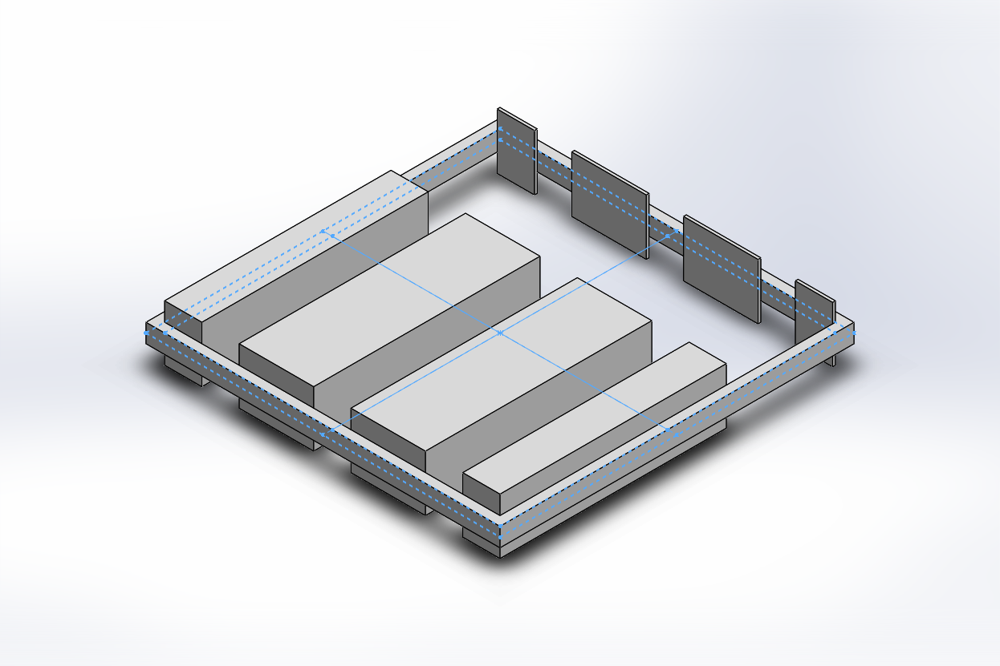
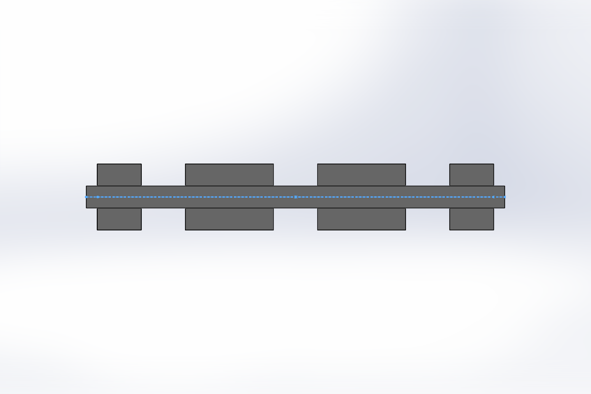
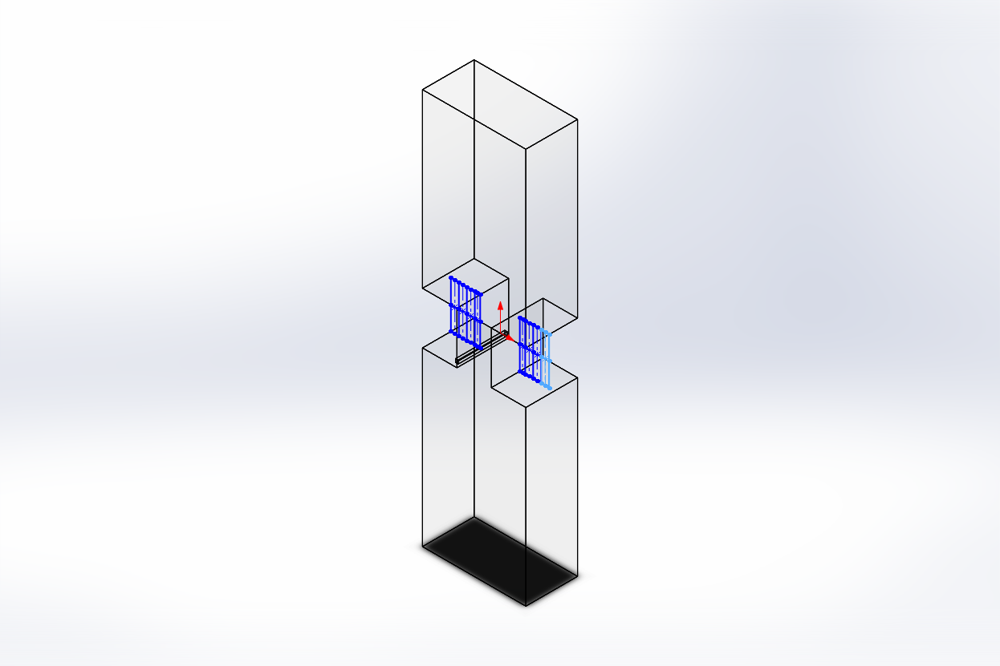

# Air-Permeable Acoustic Metamaterial Window Insert

> **Continuous Natural Ventilation Coupled with Broadband Destructive Interference Sound Cancellation**  
> *A Course Project for Computer-Aided Product Development (CAPD)*



---

## 👥 Project Team & Academic Credentials

* **Course**: Computer-Aided Product Development (CAPD)
* **Team Members / Presenters**:
  * **N. SARATH PAVAN KUMAR** — Roll No: `24BSM040`
  * **PALTHI ANJI** — Roll No: `24BSM041`
* **Course Instructor**: **DR. AVINASH RAVI RAJA**  
* **Department**: Department of Mechanical Engineering

---

## 📌 Executive Summary & The Urban Dilemma

In dense modern metropolitan environments, hospitals, schools, and factory offices, room occupants face a strict, historically unresolved engineering dilemma:
1. **The Open Window Dilemma**: Opening windows provides natural fresh air and passive cooling, but floods interior rooms with unbearable exterior ambient noise ($75$ to $85+\text{ dB(A)}$) from highway traffic, trains, sirens, and machinery.
2. **The Sealed Window Trap**: Closing and sealing windows blocks exterior sound, but creates airtight indoor environments that trap carbon dioxide ($\text{CO}_2$), humidity, and volatile organic compounds (VOCs). This creates extreme dependency on energy-intensive mechanical HVAC systems.
3. **The Acoustic Mass Law Limitation**: Traditional architectural soundproofing relies strictly on **Mass Law** ($\text{TL} \propto 20 \log(m \cdot f)$), which dictates that sound insulation requires dense, heavy, airtight solid barriers (thick masonry, heavy laminated double-glazing). Conventional sound-absorbing foam and louvers restrict airflow and fail completely at lower and mid-range traffic frequencies ($400 - 1500\text{ Hz}$).

### The Metamaterial Breakthrough: "Geometry as the Machine"
This project designs and manufactures an **Air-Permeable Acoustic Metamaterial Window Insert**. Rather than relying on heavy mass or powered electronic noise cancellation, **the physical geometry itself performs the cancellation**. By folding acoustic pathways into space-coiling labyrinthine sub-wavelength resonators, sound waves destroy themselves through phase interference while bulk fresh air passes continuously through a wide central ventilation duct.

---

## 🔬 How the Product Works: Physical Principles & Science

```
                          ┌─────────────────────────────────────┐
                          │    Folded Perimeter Labyrinth       │
                          │   (Extended Path: L2 = L1 + λ/2)    │
                          └──────────────────▲──────────────────┘
                                             │ (Sound Detour)
[ Outdoor Noise + Breeze ] ──────────────────┼────────────────────► [ Fresh Breeze Indoors ]
  (75 - 85 dB Traffic)                       │                      (Noise Suppressed >30 dB)
                                             ▼
                          ┌─────────────────────────────────────┐
                          │    Central Ventilation Airway       │
                          │        (Direct Path: L1)            │
                          └─────────────────────────────────────┘
```

The system operates on four coupled physical principles without any sensors, microcontrollers, speakers, or power supplies:

### 1. Acoustic Wave Splitting (Bifurcation)
When ambient sound waves reach the unit cell aperture, they encounter a dual-channel acoustic junction:
* A direct, low-resistance central ventilation core ($20\text{ mm}$ wide).
* Symmetric side entry doorways ($3.0\text{ mm}$ slits) leading into coiled serpentine chambers.

### 2. Path Difference & Half-Wavelength ($\lambda/2$) Delay
Sound travels through air as longitudinal pressure oscillations consisting of alternating compressions (crests) and rarefactions (troughs).
* Sound traveling through the central airway takes the straight, short route ($L_1 = 30\text{ mm}$).
* Sound entering the side labyrinth is forced through an interdigitated folded channel ($L_2 \approx 107\text{ mm}$).
* The difference between these two paths ($\Delta L = L_2 - L_1$) is engineered to equal exactly **one half of the acoustic wavelength** ($\Delta L = \lambda / 2$) for target urban traffic rumble ($400 - 1500\text{ Hz}$).

### 3. Destructive Wave Interference (Phase Inversion)
Because the wave in the labyrinth travels an extra half-wavelength, it emerges from the side chamber exactly **$180^\circ$ out of phase** relative to the direct wave:
$$\Delta \phi = k \cdot \Delta L = \pi \quad (180^\circ)$$
At the recombination zone:
* A pressure peak (crest) of the direct wave meets a pressure valley (trough) of the labyrinth wave.
* The positive and negative pressure perturbations superpose, canceling the net acoustic pressure to near zero ($P_{\text{net}} \approx 0$).

### 4. Continuous Natural Airflow Preservation
Sound waves are microscopic oscillating pressure fluctuations, whereas ventilation is bulk, steady fluid drift. 
* Fluid airflow has mass and momentum; it naturally follows the path of least resistance through the straight, open $20\text{ mm}$ central airway.
* Because the central core remains **33.3% open cross-section**, room ventilation and convective heat transfer occur unhindered with negligible static pressure drop.

---

## 🧩 Detailed Breakdown of Individual Components

| Component Render | Component Name | Functional Role & Architecture |
| :---: | :--- | :--- |
|  | **1. Central Airway Channel** | • **Dimensions**: $20.0\text{ mm}$ wide $\times 30.0\text{ mm}$ high $\times 30.0\text{ mm}$ deep.<br>• **Function**: Unobstructed central ventilation duct providing a 33.3% open cross-section for natural room breathing with zero bulk airflow resistance.<br>• **Acoustic Role**: Acts as the primary conduit and recombination mixing zone where delayed waves cancel direct waves. |
|  | **2. Serpentine Labyrinth Baffles** | • **Dimensions**: 3 staggered vertical partitions, $1.50\text{ mm}$ wall thickness, $23.0\text{ mm}$ height.<br>• **Function**: Compresses an extended $\approx 107\text{ mm}$ acoustic travel path into a compact $20\text{ mm}$ wide side envelope.<br>• **Acoustic Role**: Alternating floor-to-ceiling attachments prevent wave short-circuiting and guide sound through 4 full folded passes. |
|  | **3. Acoustic Entry Slits** | • **Dimensions**: $2.00\text{ mm}$ calibrated entry doorways positioned at the bottom of the inner airway walls.<br>• **Function**: Captures oscillating acoustic pressure waves while allowing bulk ventilation airflow to bypass through the open duct.<br>• **Acoustic Role**: Acoustic impedance portal linking the central airway to the dead-end resonant labyrinth chambers. |
|  | **4. Labyrinth Cavity & Back Plate** | • **Dimensions**: $1.50\text{ mm}$ solid back plate ($Z = -30.0\text{ mm}$) with $28.5\text{ mm}$ deep open-top acoustic chambers.<br>• **Function**: Matches the exact 3D cutaway cassette view from the design blueprint, cleanly exposing the internal baffles.<br>• **Acoustic Role**: Seals the rear acoustic cavity while providing rigid acoustic impedance boundaries ($Z_{\text{wall}} \gg Z_{\text{air}}$). |
|  | **5. 3x3 Modular Panel Matrix** | • **Dimensions**: $180.0\text{ mm} \times 180.0\text{ mm} \times 30.0\text{ mm}$ monolithic lattice.<br>• **Function**: Full architectural window cassette combining 9 unit cells into 3 parallel continuous ventilation corridors.<br>• **Acoustic Role**: Multiplies acoustic cancellation zones (18 side resonators) across the full window aperture. |
|  | **6. Window-Track Flange & Gasket** | • **Dimensions**: $5.0\text{ mm}$ wide perimeter lip ($190 \times 190\text{ mm}$ outer) with $1.5\text{ mm} \times 45^\circ$ lead-in chamfers.<br>• **Function**: Toolless retrofitting into existing sliding window frames.<br>• **Acoustic Role**: Compresses firmly against architectural rubber weatherstripping to prevent flanking edge noise. |
|  | **7. Inverse Acoustic Air Domain** | • **Dimensions**: $60.0\text{ mm} \times 230.0\text{ mm} \times 30.0\text{ mm}$.<br>• **Function**: Watertight negative volume modeling the sound and airflow pathways.<br>• **Acoustic Role**: Includes $100\text{ mm}$ upstream and downstream duct ports for impedance and transmission loss simulation. |

---

## 📐 Parametric CAD Formulation (SolidWorks 2022)

The geometry is 100% equation-driven. All dimensions are derived from global parameters linked in the SolidWorks Equation Manager:

| Global Variable | SolidWorks Equation / Formula | Evaluated Value | Engineering / Geometric Purpose |
| :--- | :--- | :---: | :--- |
| `W_cell` | `60mm` | **60.00 mm** | Total width of one unit cell (X-direction) |
| `H_cell` | `30mm` | **30.00 mm** | Total height of one unit cell (Y-direction) |
| `D_cell` | `30mm` | **30.00 mm** | Extrusion depth of one unit cell (Z-direction) |
| `W_airway` | `20mm` | **20.00 mm** | Central unobstructed ventilation duct width (33.3% open) |
| `t_wall` | `1.5mm` | **1.50 mm** | Wall and baffle thickness (uniform across all partitions) |
| `w_slit_entry`| `2.0mm` | **2.00 mm** | Acoustic entry slit doorway into resonator chamber |
| `N_passes` | `4` | **4** | Number of folded vertical passes per side chamber |
| `W_chamber`| `("W_cell" - "W_airway") / 2` | **20.00 mm** | Total width of each side resonator chamber |
| `w_slit` | `("W_chamber" - ("N_passes" + 1) * "t_wall") / "N_passes"` | **3.125 mm** | Exact width of each folded acoustic channel |
| `L_baffle` | `"H_cell" - (2 * "t_wall") - "w_slit_entry"` | **23.00 mm** | Exact vertical length of each internal baffle wall |
| `L_waveguide`| `100mm` | **100.00 mm** | Upstream & downstream simulation duct port length |

*The parametric equations file is available at [`metamaterial_equations.txt`](metamaterial_equations.txt) and can be imported directly into any SolidWorks part via `Tools > Equations > Import`.*

---

## 🖨️ Design for Additive Manufacturing (DFAM) Specifications

The entire unit cell and 3x3 array are optimized for rapid additive manufacturing without sacrificial supports:

* **Recommended Material**: **ABS (Acrylonitrile Butadiene Styrene)** or **PETG (Polyethylene Terephthalate Glycol)** for high acoustic impedance ($Z_{\text{wall}} \gg Z_{\text{air}}$) and UV/weather resistance.
* **Nozzle Diameter**: Standard $0.4\text{ mm}$ FDM nozzle.
* **Perimeter Wall Configuration**: Exactly 4 solid perimeters ($4 \times 0.4\text{ mm} = 1.6\text{ mm}$ solid wall), eliminating hollow infill in internal baffles and guaranteeing airtight acoustic boundaries.
* **Build Orientation**: Printed vertically with the Z-axis aligned with the printer's build direction, allowing all vertical labyrinth baffles and airway walls to print self-supported without internal overhangs.
* **Estimated Mass**: $\approx 220\text{ g}$ for the full monolithic $180 \times 180 \times 30\text{ mm}$ ABS panel.

---

## 📂 Repository File Directory

```
├── CAD Models /
│   ├── Solid_Metamaterial_Frame.SLDPRT   # Native SolidWorks 2022 Part: Single Unit Cell
│   ├── Solid_Metamaterial_Frame.STEP     # Standard STEP AP214 Exchange File
│   ├── Solid_Metamaterial_Frame.STL      # 3D Printable Mesh File
│   ├── Modular_Window_Panel_3x3.SLDPRT   # Native SolidWorks 2022 Part: 3x3 Window Cassette
│   ├── Modular_Window_Panel_3x3.STEP     # Standard STEP AP214 Exchange File
│   ├── Modular_Window_Panel_3x3.STL      # 3D Printable Mesh File
│   ├── Acoustic_Air_Domain.SLDPRT        # Native SolidWorks 2022 Part: Fluid/Acoustic Domain
│   ├── Acoustic_Air_Domain.STEP          # Standard STEP AP214 Exchange File
│   └── Acoustic_Air_Domain.STL           # Fluid Domain Mesh
│
├── Presentation /
│   ├── Acoustic_Metamaterial_Presentation.pptx  # 12-Slide High-Impact Presentation
│   └── create_presentation.py                   # Automated Presentation Generator Script
│
├── Automation & Code /
│   ├── build_all_models.py               # Python win32com Automation Generator
│   ├── Acoustic_Metamaterial_Macro.bas   # Native SolidWorks VBA Macro Script
│   ├── metamaterial_equations.txt        # SolidWorks Parametric Global Variables Text File
│   └── make_concept_diagram.py           # Matplotlib Conceptual Physics Diagram Generator
│
├── Visual Assets /
│   ├── concept_how_it_works.png          # High-Resolution Physical Principle Graphic
│   ├── render_unit_cell_iso.png          # Isometric Render of Unit Cell
│   ├── render_unit_cell_front.png        # Front Cross-Section Render of Unit Cell
│   ├── render_unit_cell_top.png          # Top View Showing Sealed End-Caps
│   ├── render_panel_3x3_iso.png          # Isometric Render of 3x3 Window Panel
│   ├── render_panel_3x3_front.png        # Front View of 3x3 Window Panel
│   └── render_air_domain_iso.png         # Isometric Render of Acoustic Air Domain
│
└── README.md                             # Comprehensive Project Documentation
```

---

## 🚀 How to Use & Recreate the Project

### 1. Opening in SolidWorks
1. Open **SOLIDWORKS 2022** (or newer).
2. Go to `File > Open` and select `Solid_Metamaterial_Frame.SLDPRT` or `Modular_Window_Panel_3x3.SLDPRT`.
3. To inspect parametric formulas, go to `Tools > Equations`.

### 2. Running the SolidWorks VBA Macro
1. In SolidWorks, open a blank part document.
2. Go to `Tools > Macro > Run`.
3. Select `Acoustic_Metamaterial_Macro.bas` to automatically construct the unit cell from scratch.

### 3. Re-Generating All Models via Python
If you have Python with `pywin32` installed on Windows with SolidWorks:
```bash
python build_all_models.py
```

### 4. Viewing or Editing the Presentation
Open `Acoustic_Metamaterial_Presentation.pptx` in Microsoft PowerPoint, Google Slides, or Keynote. All slides feature widescreen 16:9 layout, embedded SolidWorks renders, and concise 3-4 bullet conceptual layouts.

---

## 📜 License & Acknowledgments

Developed as part of the **Computer-Aided Product Development (CAPD)** curriculum under the guidance of **Dr. Avinash Ravi Raja**. Released for open academic, research, and non-commercial development.
